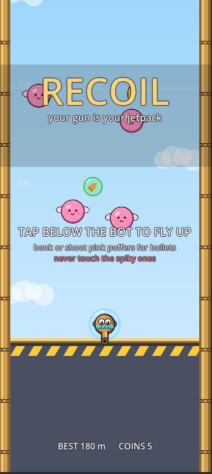

# Recoil

A one-thumb mobile arcade game made in **Godot 4**. Your gun is your jetpack: tap below your bot to shoot down and fly up. Bonk or shoot the pink puffers to get bullets back, and never touch the spiky ones.

<p align="center"></p>

It grew out of four quick shooter prototypes (Gungry, Echo Army, Ricochet Heist and Recoil) built to find the most fun idea.

## Built with
- Godot 4 (GDScript), portrait 1080×2400, mobile renderer
- All art drawn in code (`art/`), no image assets
- Fonts: Fredoka and Lilita One (SIL Open Font License, see `fonts/`)

## Project layout
```
game/      game loop, player, spawner, world, zones
art/       procedural drawing for the bot, enemies, loot, sky and tower
ui/        HUD, screens and widgets
autoload/  save data and sound effects
core/      batching and visual effects helpers
```

## Run it
Open `project.godot` in Godot 4 and press Play.
